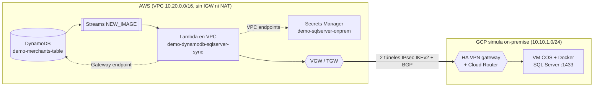

# Demo: VPN site-to-site entre AWS y Google Cloud (Terraform)

## Propósito

Este demo reproduce, en pequeño y con datos 100% ficticios, un caso real: replicar
una tabla de **DynamoDB** hacia un **SQL Server on-premise** para poder hacer
consultas SQL más elaboradas. En el caso real, la conexión AWS ↔ on-premise va por
**AWS Direct Connect**, que es costoso de mantener en ambientes de staging o dev.

Aquí **Google Cloud simula el on-premise** (una VM con SQL Server en Docker) y
**Direct Connect se sustituye por una VPN site-to-site** de 2 túneles con BGP (sin alta disponibilidad, al ser un demo).
Todo se crea con Terraform en una carpeta aislada y con estado local.

## Arquitectura



```text
 DynamoDB --Streams--> Lambda (VPC privada) --1433--> [VGW] ==2 túneles== [HA VPN GCP] --> VM SQL Server
                          |                                                  (Cloud Router BGP 65010)
                          +--443--> endpoints VPC (DynamoDB / Secrets Manager)
```

## Recursos principales

| Recurso | Archivo | Descripción |
|---|---|---|
| VPC, 2 subnets privadas, endpoints | `network_aws.tf` | Sin IGW ni NAT; endpoint Gateway de DynamoDB e Interface de Secrets Manager |
| VGW (o TGW) | `network_aws.tf` | `aws_target_gateway = "vgw"` por defecto |
| VPC, subnet, firewall | `network_gcp.tf` | Único ingress por defecto: tcp/1433 desde las subnets privadas de AWS |
| VPN site-to-site | `vpn.tf` | 1 customer gateway, 1 conexión VPN, 2 túneles, 2 sesiones BGP |
| VM SQL Server | `gcp_sqlserver.tf`, `gcp/` | Container-Optimized OS + Docker, `init.sql` idempotente |
| DynamoDB + control + secreto | `aws_data.tf` | `demo-merchants-table` (Streams), `demo-sync-control`, `demo-sqlserver-onprem` |
| Lambda | `aws_lambda.tf`, `lambda/` | `demo-dynamodb-sqlserver-sync`, Python 3.12, pymssql |
| Streams (opcional) | `streams.tf` | DLQ + event source mapping, solo con `enable_streams_sync = true` |

## Decisión: 2 túneles, sin HA

- 1 HA VPN gateway en GCP (2 interfaces) y 1 Cloud Router. BGP se mantiene: HA VPN de Google exige rutas dinámicas.
- 1 `aws_customer_gateway` (IP de la interfaz 0 de GCP) y 1 `aws_vpn_connection` dinámica con **2 túneles**.
- Una conexión VPN de AWS apunta a una sola customer gateway, por eso **ambos túneles salen de la interfaz 0** de GCP; la interfaz 1 queda sin usar.
- 1 `google_compute_external_vpn_gateway` con `TWO_IPS_REDUNDANCY` (interfaz 0 = IP del túnel 1 de AWS, interfaz 1 = IP del túnel 2).
- Con 2 túneles en una sola interfaz **no aplica el SLA de 99.99%** de HA VPN (requiere 4 túneles: 2 conexiones, una por interfaz de GCP). Para el demo no importa; para producción usa la topología de 4 túneles con `FOUR_IPS_REDUNDANCY`.
- IKEv2 y un solo set de cifrado (AES256, SHA2-256, DH 14) para evitar fallos de rekey por fragmentación IKE.
- ASNs: Cloud Router GCP `65010`, lado AWS `64512`.

## VGW vs TGW

El default es **VGW**: es más simple y barato (TGW cobra por attachment y por GB procesado).
Solo TGW soporta ECMP, que este demo no necesita. Si lo quieres probar:
`terraform apply -var aws_target_gateway=tgw`.

## Costos aproximados y destroy

Valores de referencia, confirma en las páginas oficiales de precios:

- 1 conexión VPN de AWS: ~0.05 USD por conexión-hora (≈3.6 USD por 3 días). Antes, con 2 conexiones, el doble.
- VPC endpoint de Secrets Manager (1 subnet): ~0.01 USD/hora.
- VM `e2-medium` en GCP y su disco de 30 GB.

Son costos por hora: **destruye al terminar** con `terraform destroy`. El secreto usa
`recovery_window_in_days = 0` para poder recrearlo sin esperas.

## Prerrequisitos

- Terraform >= 1.5, AWS CLI, `gcloud`, `jq`, `python3` y `pip` con acceso a internet.
- Credenciales **propias** (no incluidas en este repo):
  - AWS: perfil o variables de entorno de tu cuenta (opcional `aws_profile`).
  - GCP: `gcloud auth application-default login` con tu cuenta personal y un proyecto con facturación.

## Pasos

```bash
# 1. Configuración
cp terraform.tfvars.example terraform.tfvars   # edita gcp_project_id y lo que necesites

# 2. Empaquetar la Lambda (requiere red para pip)
./scripts/build-lambda.sh

# 3. Desplegar (revisa el plan antes de aplicar)
terraform init
terraform plan
terraform apply

# 4. Verificar los túneles y BGP (solo lectura)
./scripts/check-vpn.sh

# 5. Cargar datos ficticios en DynamoDB
python3 -m venv .venv && . .venv/bin/activate
pip install -r scripts/requirements-scripts.txt
python scripts/seed_dynamodb.py --region us-east-1

# 6. Full load: primero dry-run, luego real
./scripts/full-load.sh --dry-run
./scripts/full-load.sh

# 7. Activar replicación por Streams (el seed no dispara eventos porque el mapping estaba apagado)
terraform apply -var enable_streams_sync=true
# IMPORTANTE: el mapping arranca en LATEST. Cualquier INSERT/UPDATE hecho ANTES de que
# el mapping este Enabled nunca llega a SQL Server (sin error ni DLQ) y los conteos
# difieren en 1. No hagas INSERTs de prueba antes de este paso. Si ocurre, repara con
# ./scripts/full-load.sh (MERGE idempotente) y compara conteos con verify-sql.sh.

# 8. Demo en vivo
./scripts/demo-live.sh insert
./scripts/demo-live.sh update <merchant_id> SUSPENDIDO 2500

# 9. Verificar SQL Server desde la Lambda (ping y count)
./scripts/verify-sql.sh

# 10. Limpiar
terraform destroy
```

Variables útiles de los scripts: `FUNCTION_NAME`, `TABLE_NAME`, `CONTROL_TABLE`, `WAIT_SECONDS`
y, para la parte GCP de `check-vpn.sh`, `GCP_PROJECT`, `GCP_REGION`, `ROUTER_NAME` (nombre del Cloud Router;
visible en la consola o con `gcloud compute routers list`).

### Acciones de la Lambda

La Lambda acepta eventos para verificar en vivo sin abrir puertos extra al on-premise simulado:

- `{"action":"ping"}`: abre conexión y devuelve `@@SERVERNAME` y `@@VERSION`.
- `{"action":"count"}`: devuelve `COUNT(*)` de la tabla destino; con `"merchant_id"` devuelve además esa fila.
- `{"full_scan":true,"dry_run":true,"start_key":{...}}`: full load paginado. El corte por tiempo devuelve
  como checkpoint la clave del último item procesado y siempre se procesa al menos un item por invocación.

## Seguridad

- Firewall de GCP: solo tcp/1433 desde las subnets privadas de AWS. SSH está apagado (`enable_iap_ssh = false`); si lo activas, solo desde el rango de IAP.
- La Lambda tiene un Security Group mínimo: sin ingress; egress 1433 al CIDR de GCP y 443 solo a los endpoints. Nada hacia `0.0.0.0/0`.
- Las contraseñas se generan con `random_password` y el secreto se guarda en Secrets Manager. Quedan en el **estado local** de Terraform.
- No subas `terraform.tfstate*` ni `terraform.tfvars` al repositorio (ya están en `.gitignore`).
- La VM tiene IP externa efímera solo para descargar la imagen de SQL Server (`assign_public_ip`); el firewall no permite ingress desde internet.

## Verificar túneles y BGP
```bash
./scripts/check-vpn.sh   # AWS: 2 túneles (UP) y GCP: 2 túneles + 2 sesiones BGP (con GCP_PROJECT, GCP_REGION, ROUTER_NAME)
aws ec2 describe-vpn-connections --filters "Name=tag:Project,Values=demo-aws-gcp-vpn" --query 'VpnConnections[].VgwTelemetry[].[OutsideIpAddress,Status,StatusMessage]' --output table
gcloud compute routers get-status <router> --region <region> --format="table(result.bgpPeerStatus[].name,result.bgpPeerStatus[].state)"
```
## Troubleshooting

- **Túnel DOWN**: revisa `./scripts/check-vpn.sh`; confirma que las PSK coinciden (las gestiona Terraform) y que los 2 túneles usan IKEv2. AWS inicia el túnel (`startup_action = start`), puede tardar unos minutos.
- **Falla el rekey IKE**: suele ser fragmentación por ofrecer varios sets de cifrado; este demo fija uno solo. No lo amplíes.
- **BGP no establece**: el túnel debe estar UP primero; verifica los ASN (65010 / 64512) y los rangos `169.254.10.x/30` de cada túnel con `gcloud compute routers get-status`.
- **Lambda con timeout hacia 1433**: revisa la propagación de rutas en la route table privada (VGW), la ruta al CIDR de GCP, el firewall de GCP (origen = subnets privadas de AWS), que el contenedor `sqlserver` esté arriba en la VM y el egress 1433 del SG de la Lambda.
- **SQL Server tarda en estar listo**: la VM descarga la imagen al arrancar; revisa el serial output de la VM (`gcloud compute instances get-serial-port-output`).
- **Lambda no llega a Secrets Manager o DynamoDB**: sin NAT dependen de los VPC endpoints; confirma `private_dns_enabled` y el SG del endpoint.

## Guion sugerido (20 min, RoxsFest 12-nov-2026)

1. **(2 min) El problema**: DynamoDB no permite SQL elaborado; la solución real replica a SQL Server on-premise por Direct Connect, caro para dev/staging.
2. **(3 min) La idea del demo**: GCP como on-premise simulado, VPN site-to-site en lugar de Direct Connect. Mostrar el diagrama.
3. **(3 min) La VPN**: 1 customer gateway, 1 conexión, 2 túneles, BGP, por qué no hay HA (SLA 99.99% requiere 4 túneles), VGW vs TGW.
4. **(3 min) Terraform**: recorrer `vpn.tf` y mostrar `terraform apply` ya ejecutado (los túneles tardan en levantar; deja el apply hecho antes).
5. **(2 min) Estado de la VPN**: `./scripts/check-vpn.sh` con los 2 túneles UP y las sesiones BGP.
6. **(3 min) Full load**: seed, `./scripts/full-load.sh --dry-run` y real, viendo la paginación e `./scripts/verify-sql.sh`.
7. **(3 min) En vivo**: `terraform apply -var enable_streams_sync=true`, luego `./scripts/demo-live.sh insert` y `update`.
8. **(1 min) Cierre**: seguridad, costos, `terraform destroy` y preguntas.

## Demo en vivo con el menu

Script: `scripts/demo-menu.sh` (requiere `aws` y `jq`). No necesita SSH: SQL Server se consulta invocando la Lambda dentro de la VPC, a traves de la VPN.

```bash
export AWS_PROFILE=<tu-perfil> AWS_DEFAULT_REGION=us-east-1
./scripts/demo-menu.sh        # menu interactivo
./scripts/demo-menu.sh 3      # o una opcion directa (1 a 5)
```

Opciones:

1. Cuenta los registros de DynamoDB (scan `Select=COUNT`).
2. Cuenta los registros de SQL Server (GCP) via Lambda/VPN.
3. Compara ambos: `OK` si coinciden, `DIFERENCIA` con cuantos faltan si no.
4. Crea un registro ficticio `DEMO-LIVE-<HHMMSS>` en DynamoDB y guarda su id en `/tmp/demo-last-id`.
5. Busca ese id en SQL Server cada segundo (maximo 60 s, configurable con `MAX_WAIT`) y muestra en cuantos segundos aparecio.

Orden recomendado para la charla: **3 -> 4 -> 5 -> 3**.

Consejo: ensaya antes. La primera invocacion de la Lambda puede tardar mas (arranque en frio), asi que corre la opcion 3 un par de minutos antes de empezar.

## Destruir y redesplegar rapido

`terraform.tfvars` (local, gitignored) se conserva entre ciclos. El destroy necesita el paquete de la Lambda:

```bash
./scripts/build-lambda.sh
terraform destroy -var enable_streams_sync=true   # ~20 min: las ENIs de la Lambda en la VPC tardan en liberarse
```

Redespliegue: pasos 2 a 7 de arriba (~35-45 min en total: apply ~15 min, VPN/BGP arriba ~5-10 min, seed y full load pocos minutos).
Antes de la opcion 4 del menu, confirma que el event source mapping este `Enabled`
(`aws lambda list-event-source-mappings --function-name <funcion>`): arranca en `LATEST`.
