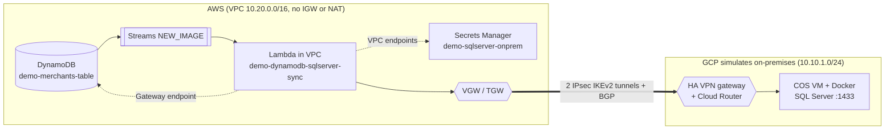

# Demo: Site-to-Site VPN between AWS and Google Cloud (Terraform)
## Purpose
This demo reproduces, on a small scale and with 100% fictitious data, a real-world case: replicating
a **DynamoDB** table to an **on-premises SQL Server** so you can run more elaborate
SQL queries. In the real case, the AWS ↔ on-premises connection goes over
**AWS Direct Connect**, which is expensive to keep running in staging or dev environments.
Here, **Google Cloud simulates the on-premises environment** (a VM running SQL Server in Docker) and
**Direct Connect is replaced by a site-to-site VPN** with 2 tunnels and BGP (no high availability, since this is a demo).
Everything is created with Terraform in an isolated folder with local state.
## Architecture

```text
 DynamoDB --Streams--> Lambda (private VPC) --1433--> [VGW] ==2 tunnels== [GCP HA VPN] --> SQL Server VM
                          |                                                  (Cloud Router BGP 65010)
                          +--443--> VPC endpoints (DynamoDB / Secrets Manager)
```
## Main resources
| Resource | File | Description |
|---|---|---|
| VPC, 2 private subnets, endpoints | `network_aws.tf` | No IGW or NAT; DynamoDB Gateway endpoint and Secrets Manager Interface endpoint |
| VGW (or TGW) | `network_aws.tf` | `aws_target_gateway = "vgw"` by default |
| VPC, subnet, firewall | `network_gcp.tf` | Only ingress by default: tcp/1433 from the AWS private subnets |
| Site-to-site VPN | `vpn.tf` | 1 customer gateway, 1 VPN connection, 2 tunnels, 2 BGP sessions |
| SQL Server VM | `gcp_sqlserver.tf`, `gcp/` | Container-Optimized OS + Docker, idempotent `init.sql` |
| DynamoDB + control table + secret | `aws_data.tf` | `demo-merchants-table` (Streams), `demo-sync-control`, `demo-sqlserver-onprem` |
| Lambda | `aws_lambda.tf`, `lambda/` | `demo-dynamodb-sqlserver-sync`, Python 3.12, pymssql |
| Streams (optional) | `streams.tf` | DLQ + event source mapping, only with `enable_streams_sync = true` |
## Design decision: 2 tunnels, no HA
- 1 HA VPN gateway in GCP (2 interfaces) and 1 Cloud Router. BGP stays: Google's HA VPN requires dynamic routing.
- 1 `aws_customer_gateway` (the IP of GCP interface 0) and 1 dynamic `aws_vpn_connection` with **2 tunnels**.
- An AWS VPN connection points to a single customer gateway, so **both tunnels terminate on GCP interface 0**; interface 1 stays unused.
- 1 `google_compute_external_vpn_gateway` with `TWO_IPS_REDUNDANCY` (interface 0 = IP of AWS tunnel 1, interface 1 = IP of tunnel 2).
- With 2 tunnels on a single interface, the **99.99% SLA** of HA VPN **does not apply** (it requires 4 tunnels: 2 connections, one per GCP interface). That does not matter for a demo; for production, use the 4-tunnel topology with `FOUR_IPS_REDUNDANCY`.
- IKEv2 and a single cipher set (AES256, SHA2-256, DH 14) to avoid rekey failures caused by IKE fragmentation.
- ASNs: GCP Cloud Router `65010`, AWS side `64512`.
## VGW vs TGW
The default is **VGW**: it is simpler and cheaper (TGW charges per attachment and per GB processed).
Only TGW supports ECMP, which this demo does not need. If you want to try it:
`terraform apply -var aws_target_gateway=tgw`.
## Approximate costs and destroy
Reference values; confirm them on the official pricing pages:
- 1 AWS VPN connection: ~0.05 USD per connection-hour (≈3.6 USD for 3 days). Before, with 2 connections, double that.
- Secrets Manager VPC endpoint (1 subnet): ~0.01 USD/hour.
- `e2-medium` VM in GCP and its 30 GB disk.
These costs accrue hourly: **destroy everything when you finish** with `terraform destroy`. The secret uses
`recovery_window_in_days = 0` so it can be recreated without waiting.
## Prerequisites
- Terraform >= 1.5, AWS CLI, `gcloud`, `jq`, `python3` and `pip` with internet access.
- **Your own** credentials (not included in this repo):
  - AWS: a profile or environment variables for your account (optional `aws_profile`).
  - GCP: `gcloud auth application-default login` with your personal account and a project with billing enabled.
## Steps
```bash
# 1. Configuration
cp terraform.tfvars.example terraform.tfvars   # edit gcp_project_id and anything else you need

# 2. Package the Lambda (requires network access for pip)
./scripts/build-lambda.sh

# 3. Deploy (review the plan before applying)
terraform init
terraform plan
terraform apply

# 4. Verify the tunnels and BGP (read-only)
./scripts/check-vpn.sh

# 5. Load fictitious data into DynamoDB
python3 -m venv .venv && . .venv/bin/activate
pip install -r scripts/requirements-scripts.txt
python scripts/seed_dynamodb.py --region us-east-1

# 6. Full load: dry-run first, then the real one
./scripts/full-load.sh --dry-run
./scripts/full-load.sh

# 7. Enable Streams replication (the seed does not trigger events because the mapping was off)
terraform apply -var enable_streams_sync=true
# IMPORTANT: the mapping starts at LATEST. Any INSERT/UPDATE made BEFORE the
# mapping is Enabled never reaches SQL Server (no error and no DLQ message) and the counts
# differ by 1. Do not run test INSERTs before this step. If it happens, repair it with
# ./scripts/full-load.sh (idempotent MERGE) and compare counts with verify-sql.sh.

# 8. Live demo
./scripts/demo-live.sh insert
./scripts/demo-live.sh update <merchant_id> SUSPENDIDO 2500

# 9. Verify SQL Server from the Lambda (ping and count)
./scripts/verify-sql.sh

# 10. Clean up
terraform destroy
```
Useful script variables: `FUNCTION_NAME`, `TABLE_NAME`, `CONTROL_TABLE`, `WAIT_SECONDS`
and, for the GCP part of `check-vpn.sh`, `GCP_PROJECT`, `GCP_REGION`, `ROUTER_NAME` (the Cloud Router name;
visible in the console or with `gcloud compute routers list`).
### Lambda actions
The Lambda accepts events so you can verify things live without opening extra ports to the simulated on-premises environment:
- `{"action":"ping"}`: opens a connection and returns `@@SERVERNAME` and `@@VERSION`.
- `{"action":"count"}`: returns `COUNT(*)` of the target table; with `"merchant_id"` it also returns that row.
- `{"full_scan":true,"dry_run":true,"start_key":{...}}`: paginated full load. When the time limit is reached, it returns
  the key of the last processed item as a checkpoint, and at least one item is always processed per invocation.
## Security
- GCP firewall: only tcp/1433 from the AWS private subnets. SSH is off (`enable_iap_ssh = false`); if you enable it, it is allowed only from the IAP range.
- The Lambda has a minimal Security Group: no ingress; egress on 1433 to the GCP CIDR and on 443 only to the endpoints. Nothing goes to `0.0.0.0/0`.
- Passwords are generated with `random_password` and the secret is stored in Secrets Manager. They remain in the **local Terraform state**.
- Do not commit `terraform.tfstate*` or `terraform.tfvars` to the repository (they are already in `.gitignore`).
- The VM has an ephemeral external IP only to download the SQL Server image (`assign_public_ip`); the firewall does not allow ingress from the internet.
## Verify tunnels and BGP
```bash
./scripts/check-vpn.sh   # AWS: 2 tunnels (UP) and GCP: 2 tunnels + 2 BGP sessions (with GCP_PROJECT, GCP_REGION, ROUTER_NAME)
aws ec2 describe-vpn-connections --filters "Name=tag:Project,Values=demo-aws-gcp-vpn" --query 'VpnConnections[].VgwTelemetry[].[OutsideIpAddress,Status,StatusMessage]' --output table
gcloud compute routers get-status <router> --region <region> --format="table(result.bgpPeerStatus[].name,result.bgpPeerStatus[].state)"
```
## Troubleshooting
- **Tunnel DOWN**: run `./scripts/check-vpn.sh`; confirm that the PSKs match (Terraform manages them) and that both tunnels use IKEv2. AWS initiates the tunnel (`startup_action = start`); it can take a few minutes.
- **IKE rekey fails**: usually caused by fragmentation when several cipher sets are offered; this demo pins a single one. Do not widen it.
- **BGP does not establish**: the tunnel must be UP first; check the ASNs (65010 / 64512) and the `169.254.10.x/30` ranges of each tunnel with `gcloud compute routers get-status`.
- **Lambda times out connecting to 1433**: check route propagation in the private route table (VGW), the route to the GCP CIDR, the GCP firewall (source = AWS private subnets), that the `sqlserver` container is up on the VM, and the egress rule on 1433 in the Lambda's SG.
- **SQL Server takes a while to be ready**: the VM downloads the image at boot; check the VM's serial output (`gcloud compute instances get-serial-port-output`).
- **Lambda cannot reach Secrets Manager or DynamoDB**: without NAT they depend on the VPC endpoints; confirm `private_dns_enabled` and the endpoint's SG.
## Suggested talk outline (20 min, RoxsFest 12-Nov-2026)
1. **(2 min) The problem**: DynamoDB does not support elaborate SQL; the real solution replicates to an on-premises SQL Server over Direct Connect, which is expensive for dev/staging.
2. **(3 min) The idea behind the demo**: GCP as a simulated on-premises environment, site-to-site VPN instead of Direct Connect. Show the diagram.
3. **(3 min) The VPN**: 1 customer gateway, 1 connection, 2 tunnels, BGP, why there is no HA (the 99.99% SLA requires 4 tunnels), VGW vs TGW.
4. **(3 min) Terraform**: walk through `vpn.tf` and show a `terraform apply` that has already run (the tunnels take a while to come up; run the apply beforehand).
5. **(2 min) VPN status**: `./scripts/check-vpn.sh` with the 2 tunnels UP and the BGP sessions.
6. **(3 min) Full load**: seed, `./scripts/full-load.sh --dry-run` and the real run, watching the pagination, and `./scripts/verify-sql.sh`.
7. **(3 min) Live**: `terraform apply -var enable_streams_sync=true`, then `./scripts/demo-live.sh insert` and `update`.
8. **(1 min) Wrap-up**: security, costs, `terraform destroy` and questions.
## Live demo with the menu
Script: `scripts/demo-menu.sh` (requires `aws` and `jq`). It does not need SSH: SQL Server is queried by invoking the Lambda inside the VPC, through the VPN.
Script output messages are in Spanish.
```bash
export AWS_PROFILE=<your-profile> AWS_DEFAULT_REGION=us-east-1
./scripts/demo-menu.sh        # interactive menu
./scripts/demo-menu.sh 3      # or run a single option directly (1 to 5)
```
Options:
1. Counts the records in DynamoDB (`Select=COUNT` scan).
2. Counts the records in SQL Server (GCP) through the Lambda/VPN.
3. Compares both: `OK` if they match, `DIFERENCIA` with the number of missing records if they do not.
4. Creates a fictitious record `DEMO-LIVE-<HHMMSS>` in DynamoDB and saves its id in `/tmp/demo-last-id`.
5. Looks for that id in SQL Server every second (60 s maximum, configurable with `MAX_WAIT`) and shows how many seconds it took to appear.
Recommended order for the talk: **3 -> 4 -> 5 -> 3**.
Tip: rehearse beforehand. The first Lambda invocation can take longer (cold start), so run option 3 a couple of minutes before you start.
## Destroy and redeploy quickly
`terraform.tfvars` (local, gitignored) is kept between cycles. The destroy needs the Lambda package:
```bash
./scripts/build-lambda.sh
terraform destroy -var enable_streams_sync=true   # ~20 min: the Lambda's ENIs in the VPC take a while to be released
```
Redeploy: steps 2 to 7 above (~35-45 min in total: apply ~15 min, VPN/BGP up ~5-10 min, seed and full load a few minutes).
Before menu option 4, confirm that the event source mapping is `Enabled`
(`aws lambda list-event-source-mappings --function-name <function-name>`): it starts at `LATEST`.
## License
MIT. See the LICENSE file.
